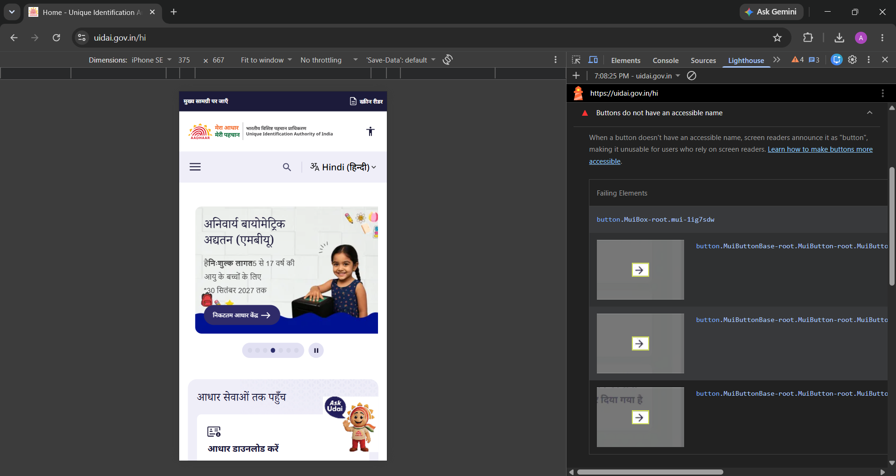
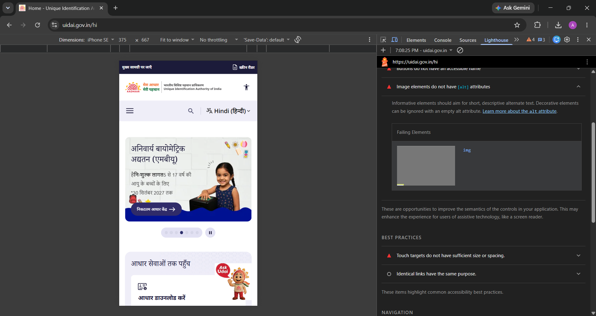
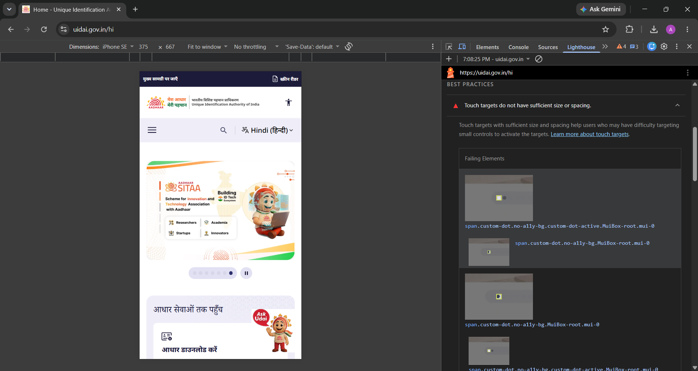
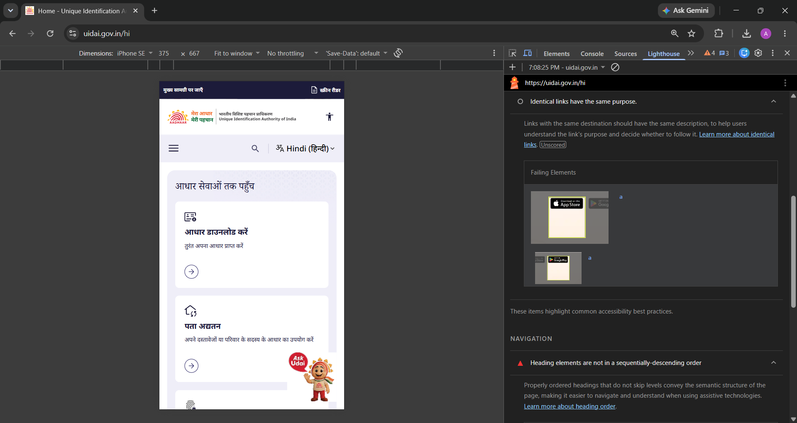
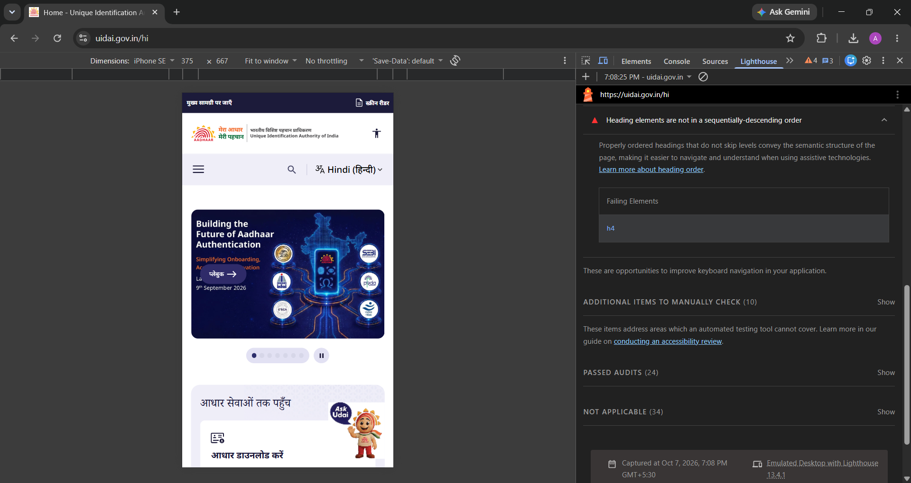

# Accessibility Baseline Audit Report

## 1. Audit Overview

**Website Audited:** UIDAI – Unique Identification Authority of India  
**URL:** https://www.uidai.gov.in/  
**Audit Tool:** Google Chrome Lighthouse  
**Accessibility Score:** 85  
**Testing Method:** Lighthouse automated audit + manual keyboard testing  
**Audit Date:** 7 October 2026

---

## 2. Summary of Findings

The audit identified five accessibility and usability findings reported by Lighthouse.

| #   | Finding                                                   | Priority |
| --- | --------------------------------------------------------- | -------- |
| 1   | Buttons do not have an accessible name                    | High     |
| 2   | Image elements do not have `alt` attributes               | High     |
| 3   | Touch targets do not have sufficient size or spacing      | Medium   |
| 4   | Identical links have the same purpose                     | Medium   |
| 5   | Heading elements are not in a sequential-descending order | Medium   |

---

## 3. Finding 1 — Buttons Do Not Have an Accessible Name

### Evidence

### Lighthouse Finding

Lighthouse reported:

> Buttons do not have an accessible name.

The report identified button elements that do not provide a clear accessible name.

### Impact

Screen-reader users may not understand the purpose of these buttons because assistive technology may announce them only as "button" without enough information about their function.

### Priority

**High**

### Recommended Remediation

Add a meaningful accessible name to every button.

For icon-only buttons, use an accessible label such as `aria-label` or provide appropriate visible text.

Example:

<button aria-label="Next slide">
  →
</button>

## 4. Finding 2 — Image Elements Do Not Have Alt Attributes

### Evidence

### Lighthouse Finding

Lighthouse reported:

> Image elements do not have [alt] attributes.

The report identified image elements without alternative text.

### Impact

Users who rely on screen readers may not receive information about informative images. This can make important visual content difficult to understand.

### Priority

**High**

### Recommended Remediation

Add meaningful alternative text to informative images.

Example:

## 5. Finding 3 — Touch Targets Do Not Have Sufficient Size or Spacing

### Evidence

### Lighthouse Finding

Lighthouse reported:

> Touch targets do not have sufficient size or spacing.

The report identified interactive elements whose touch targets are too small or too closely positioned.

### Impact

Small or closely spaced touch targets can be difficult to activate, particularly for users on mobile devices or users with motor difficulties.

### Priority

**Medium**

### Recommended Remediation

Increase the clickable area of interactive elements and provide sufficient spacing between controls.

Example:

button,
a {
min-width: 44px;
min-height: 44px;
}

## 6. Finding 4 — Identical Links Have the Same Purpose

### Evidence

### Lighthouse Finding

Lighthouse reported:

> Identical links have the same purpose.

This finding appeared under the Lighthouse **Best Practices** section.

### Impact

Links with identical text can make it difficult for users, especially screen-reader users, to distinguish between different destinations or actions when the surrounding context is not clear.

### Priority

**Medium**

### Recommended Remediation

Use descriptive link text that clearly communicates the destination or purpose of each link.

Instead of:

Read More
Read More
Read More

## 7. Finding 5 — Heading Elements Are Not in Sequential Order

### Evidence

### Lighthouse Finding

Lighthouse reported:

> Heading elements are not in a sequential-descending order.

The Lighthouse report identified an `h4` element as a failing element.

### Impact

An incorrect heading hierarchy can make the structure of a page harder to understand for users of assistive technologies, particularly users who navigate content using heading levels.

### Priority

**Medium**

### Recommended Remediation

Use heading levels in a logical hierarchy.

Example:

<h2>Services</h2>
<h3>Aadhaar Services</h3>
<h4>Enrolment</h4>
